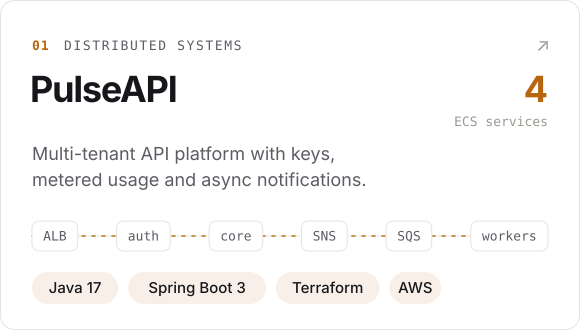
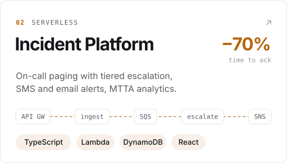

<a href="https://mohan-raj-portfolio.vercel.app">
  <picture>
    <source media="(prefers-color-scheme: dark)" srcset="assets/header-dark.svg">
    <source media="(prefers-color-scheme: light)" srcset="assets/header-light.svg">
    
  </picture>
</a>

 

I'm a software engineer in the UK, recently started in a full-time role. Most of my work happens on the backend: services, the queues between them, and the infrastructure underneath.

Outside work I rebuild systems I want to understand properly. So far that's a multi-tenant API platform based on how Stripe and Twilio work, a serverless pager that escalates through on-call tiers, and data pipelines that land clean, partitioned data in cloud storage.

 

### Selected work

  <a href="https://github.com/mohan-sys/multi-tenant-saas">
    <picture>
      <source media="(prefers-color-scheme: dark)" srcset="assets/card-pulseapi-dark.svg">
      
    </picture>
  </a>
  <a href="https://incident-platform-omega.vercel.app">
    <picture>
      <source media="(prefers-color-scheme: dark)" srcset="assets/card-incident-dark.svg">
      
    </picture>
  </a>

**PulseAPI.** Four Spring Boot services behind an ALB on ECS Fargate. Tenants sign up, get API keys, and every request is metered. Usage and notification events fan out through SNS to SQS, so the workers scale on their own. Everything is provisioned in Terraform. [Source →](https://github.com/mohan-sys/multi-tenant-saas)

**Incident Platform.** Alerts come in through API Gateway, land in DynamoDB and queue for an escalation engine that pages each on-call tier by SMS and email until someone acknowledges. Mean time to acknowledge dropped by 70%. [Live demo →](https://incident-platform-omega.vercel.app) · [Source →](https://github.com/mohan-sys/incident-platform)

 

### Recently pushed

<!-- recent:start -->
| Project | What it is | Stack | Last push |
|:--|:--|:--|--:|
| [**3D Portfolio**](https://github.com/mohan-sys/personal_3D_portfolio) | Interactive portfolio in React Three Fiber and GSAP | `JavaScript` | Aug 2026 |
| [**ETL Pipeline**](https://github.com/mohan-sys/storypoints-data-pipeline) | Chunked extract, clean and partitioned load to GCS | `Python` | Sep 2025 |
| [**Crossword**](https://github.com/mohan-sys/mohans_crossword) | Playable crossword in the browser, built with React | `JavaScript` | Jul 2025 |
| [**Song Popularity Model**](https://github.com/mohan-sys/spotify_popularity_pred) | Predicts how popular a track will be from Spotify data | `Python` | Feb 2024 |
| [**Genre Classifier**](https://github.com/mohan-sys/spotify_genre_pred) | Classifies a track's genre from Spotify data | `Python` | Feb 2024 |
<!-- recent:end -->

 

### Toolbox

<table>
  <tr><td>LANGUAGES</td><td>Java · TypeScript · Python · SQL</td></tr>
  <tr><td>BACKEND</td><td>Spring Boot · Spring Security · JPA / Hibernate · Node.js · REST</td></tr>
  <tr><td>CLOUD</td><td>AWS: ECS Fargate, Lambda, API Gateway, SQS, SNS, DynamoDB, RDS, Cognito, CloudFront</td></tr>
  <tr><td>INFRA</td><td>Terraform · AWS SAM · Docker · Kubernetes + Helm · GitHub Actions</td></tr>
  <tr><td>DATA</td><td>pandas · ETL pipelines · Google Cloud Storage · PostgreSQL · MySQL</td></tr>
  <tr><td>FRONTEND</td><td>React · Vite · Tailwind · Three.js</td></tr>
</table>

 

### Elsewhere

[Portfolio](https://mohan-raj-portfolio.vercel.app) &nbsp;·&nbsp; [LinkedIn](https://linkedin.com/in/mohan-raj-9b981b1a0) &nbsp;·&nbsp; [mohanrajloganathan9@gmail.com](mailto:mohanrajloganathan9@gmail.com)

 

<!-- updated:start -->
Runs on coffee &nbsp;·&nbsp; synced from the GitHub API 25 Nov 2026
<!-- updated:end -->
